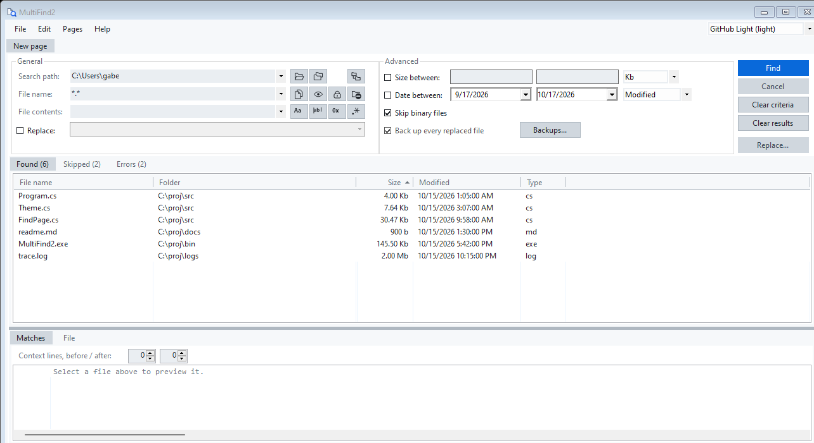
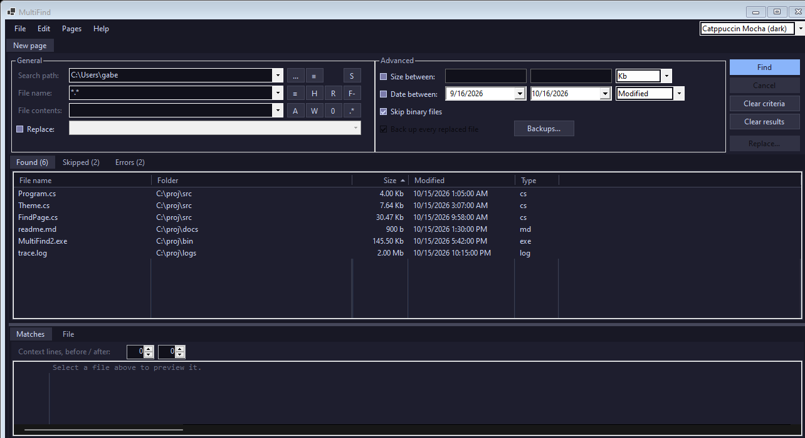

# MultiFind2

A multi-criteria file search tool for Windows: find files by name, path, size, date and content,
across several folders at once, and replace inside the files you found.



## Why

It is a rewrite of [Midlinesoft MultiFind](http://www.midlinesoft.com/) 1.51, a tool worth using
daily but with three problems that a rewrite could fix:

- **The Modified column showed only the date.** Sorting a result set chronologically was therefore
  impossible. Here it shows date *and* time, and sorts on the real timestamp rather than on text.
- **Cancel took two clicks** — the search stopped and immediately started again. Find and Cancel are
  now separate buttons, exactly one of which is ever enabled, and cancelling is one click.
- **It crashed.** Searching runs off the UI thread with proper cancellation, unreadable files are
  collected on a Skipped and an Errors tab instead of aborting the run, and the session is written
  to disk as you go rather than only on exit.

## What it does

**Searching**

- Several roots at once (`C:\src;D:\build`), with include and exclude lists for both folder names
  and file names
- Wildcards or regular expressions, case and whole-word options, hex search
- Filter by size range, by date range on created/modified/accessed, and by hidden / read-only /
  folder as three-state toggles (any / only / never)
- Binary files skipped by default, and reported rather than silently dropped
- Optionally descend into compressed files — zip, 7z, rar, gzip and tar — treating each archive as
  a folder, so the name, size, date and content filters all apply to the entries inside it. Off by
  default, because opening every archive on the way past costs real time.

**Reading the results**

- Virtual-mode list, so a result set of hundreds of thousands of rows stays responsive
- Sortable on every column, including a real Modified timestamp. The header can be clicked while a
  search is still running, and the order chosen then holds as results keep arriving
- A preview pane showing each matching line with the hits highlighted, with grep-style `-A`/`-B`
  context line counts. It opens on the first hit, scrolling sideways if the match sits far along
  a long line
- Text can be dragged out of the preview and copied with Ctrl+C; double-click takes a word,
  Ctrl+A the lot
- Explorer's own right-click menu on the selected rows: Open with, Send to, 7-Zip, TortoiseGit,
  Properties and whatever else is installed

**Replacing**

- Literal or regular-expression replace across the files found, or only the ones selected
- Only files on disk are rewritten. Anything found inside a compressed file is left alone and
  counted in the confirmation, so a replace never has to unpack and rebuild an archive.
- A preview of what will change before anything is written, and a Replaces count per file
- Originals are backed up under `%TMP%\MultiFind2\Backups\<page>\<timestamp>\`, mirroring the
  original folder structure, reachable from a **Backups...** button. Runs older than 10 days are
  discarded at startup.
- If the files to back up would exceed 10% of the free space on the `%TMP%` volume, it says so and
  offers to go ahead without a backup
- The backup is taken *before* the rewrite and is not swallowed on failure: a file that cannot be
  backed up is not overwritten

**Elsewhere**

- Tabbed pages, each with its own criteria, restored on the next launch along with the drop-down
  history
- Fifteen colour themes, light and dark, following the Windows app theme until you pick one



## Install

Download `MultiFind2.exe` from the [latest release](../../releases/latest) and run it. It is
self-contained — no .NET installation is needed.

## Build

Requires the [.NET 8 SDK](https://dotnet.microsoft.com/download/dotnet/8.0). The one dependency is
[SharpCompress](https://github.com/adamhathcock/sharpcompress) (MIT), which reads the archives.

```
dotnet build -c Release
```

To produce the single-file executable that ships in the releases:

```
dotnet publish MultiFind2/MultiFind2.csproj -c Release -r win-x64 ^
    --self-contained true -p:PublishSingleFile=true ^
    -p:EnableCompressionInSingleFile=true -o publish
```

## Settings

Pages, drop-down history and the chosen theme live in
`%APPDATA%\MultiFind2\settings.json`. Both paths can be redirected with the `MULTIFIND2_SETTINGS`
and `MULTIFIND2_BACKUPS` environment variables.
